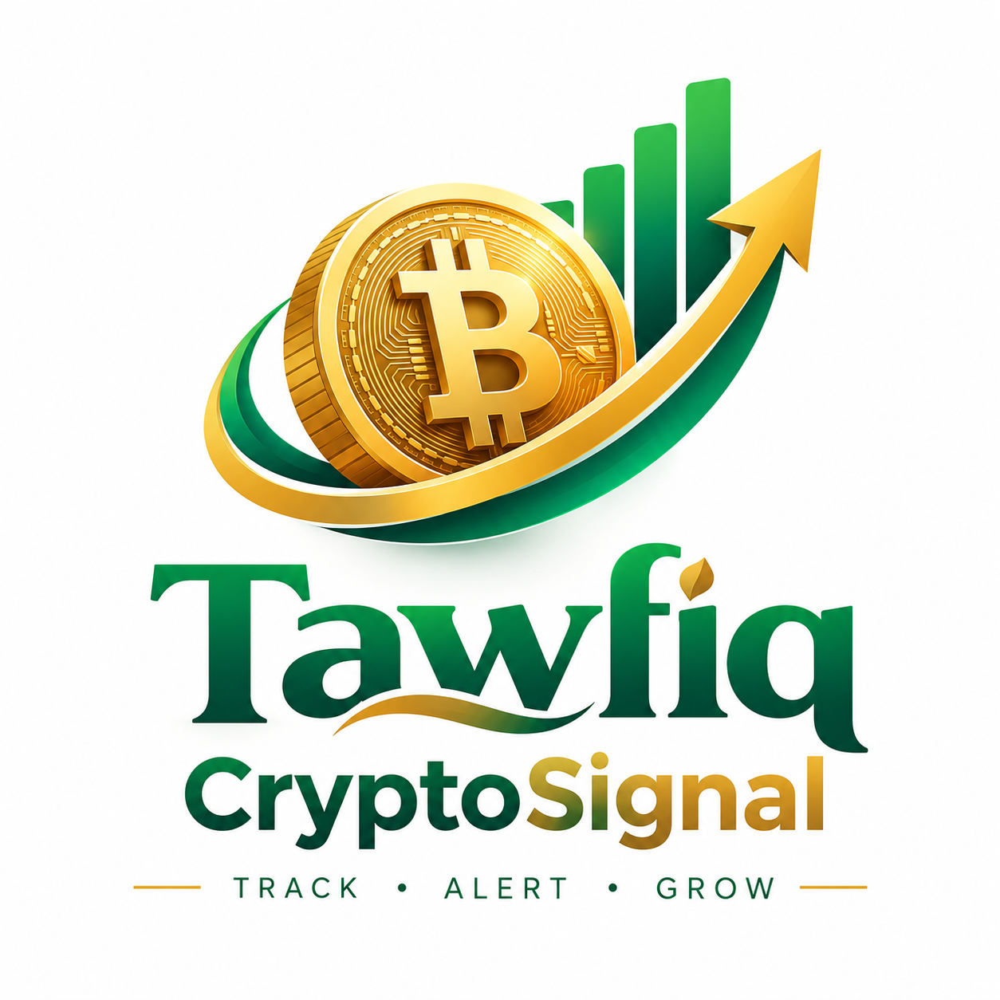

# Tawfiq CryptoSignal 📈
Personal crypto portfolio monitor for Android — tracks a Binance investment made **28 Oct 2026** and alerts on gains/losses. **Monitoring only: no trading, no transfers, no Binance login.**



## Portfolio baseline (editable in Settings, never overwritten by prices)
| Asset | Reference price | Invested | Quantity |
|---|---|---|---|
| BTC | $80,642.26 | $500 | 0.006198 BTC |
| BNB | $752.08 | $300 | 0.398894 BNB |
| XRP | $1.32 | $200 | 151.52 XRP |
| USDT (emergency reserve, separate) | $1.00 | $200 | 200 USDT |
| **Total** | | **$1,200** ($1,000 crypto + $200 reserve) | |

## Features
- **Dashboard**: total/current/initial value, P/L $ + %, crypto-only return, reserve, best/worst coin, 24h vs since-purchase (kept separate), last update + source.
- **My Portfolio**: per-coin qty × live price, value, P/L since purchase.
- **Market Highlights**: CoinGecko top-50 (price, 24h %, high/low, volume), gainers/losers, search. Market-wide ≠ your portfolio.
- **Price Alerts**: portfolio % up/down (1/2/3/5% presets + custom), target above/below, P/L $; per-coin % vs purchase price, targets, new 24h high/low. Per-coin enable, cooldown (default 60 min), dedup, Room history.
- **Charts**: total value, P/L, BTC/BNB/XRP values and allocation — from snapshots this app records (no invented pre-install history). Filters 24h/7d/30d/90d/Since 28 Oct 2026.
- **Settings**: edit qty/purchase price, alert enable per coin, Render backend URL, test notification, API status/last sync, CSV export preview, clear snapshots.
- Branding: your uploaded logo used verbatim (`logo-original.png`, splash + in-app; launcher icon cropped from its emblem).

## Live data — no mocks
Fallback chain on every refresh, each quote labelled with source + timestamp, stale >2 min flagged:
1. **Binance public REST** `https://data-api.binance.vision/api/v3/ticker/24hr` (BTCUSDT/BNBUSDT/XRPUSDT) + foreground **WebSocket** `wss://data-stream.binance.vision` (auto-reconnect/backoff).
2. **Your Render backend** (`backend/`, see below) as cache/proxy.
3. **CoinGecko public** `coins/markets` fallback + Market Highlights.
No API keys are required or embedded. USDT shown at $1.00 peg and labelled as such.

## Background alerts — honest timing
- **Foreground**: immediate (REST + WebSocket while app open).
- **Background/locked**: WorkManager periodic check every **15 minutes** (Android's minimum for periodic work). Battery optimisation / network may delay it — the app states this in Alerts. Test on a physical device and exclude the app from battery optimisation for most reliable checks.

## Repo layout
```
app/            Android app (Kotlin, Jetpack Compose, MVVM, SQLite, Retrofit/OkHttp, WorkManager)
backend/        FastAPI price proxy/cache (no secrets, no portfolio data)
render.yaml     Render Blueprint
logo-original.png  Your original uploaded logo
```

## Build the APK
Requires JDK 17 + Android SDK 35.
```bash
./gradlew assembleDebug   # app/build/outputs/apk/debug/app-debug.apk
./gradlew testDebugUnitTest
```
Install: copy the APK to your phone and open it (allow "install unknown apps"), or `adb install app-debug.apk`.
Release: create your own keystore (`keytool -genkeypair -keystore tawfiq.jks -alias tawfiq -keyalg RSA -keysize 2048 -validity 10000`), wire it into `app/build.gradle.kts` signingConfigs — never commit passwords. Back up the keystore: losing it = cannot update the app.

## Deploy backend to Render + GitHub
1. Create an empty GitHub repo, then:
```bash
git init && git add . && git commit -m "Tawfiq CryptoSignal v1.0" && git branch -M main
git remote add origin https://github.com/<you>/<repo>.git && git push -u origin main
```
2. render.com → New + → Blueprint → select the repo → Apply. Your URL will be `https://<service-name>.onrender.com`.
3. In the app: Settings → Render backend URL → paste that URL → Save. (Default build value: `https://tawfiq-cryptosignal.onrender.com` — rename your Render service to match, or just override in Settings.)

## Security & privacy
Local only (SQLite on-device): holdings, snapshots, rules, history. Network (HTTPS only): public price requests. No credentials, no trading/withdrawal permissions, nothing sent to third parties beyond price APIs/your own backend.

## Known limitations
- Binance may geo-restrict some regions; the chain falls back to your backend/CoinGecko automatically.
- CoinGecko free tier is rate-limited; backend caches (20–60s).
- Charts start empty and fill as snapshots accumulate.
- Dark mode: light emerald/white/gold is the designed default per spec.

> Note: `gradle/wrapper/gradle-wrapper.jar` is not committed. Generate it once with `gradle wrapper --gradle-version 8.7` (any local Gradle install) or open the project in Android Studio, which does this automatically, before running `./gradlew`.
